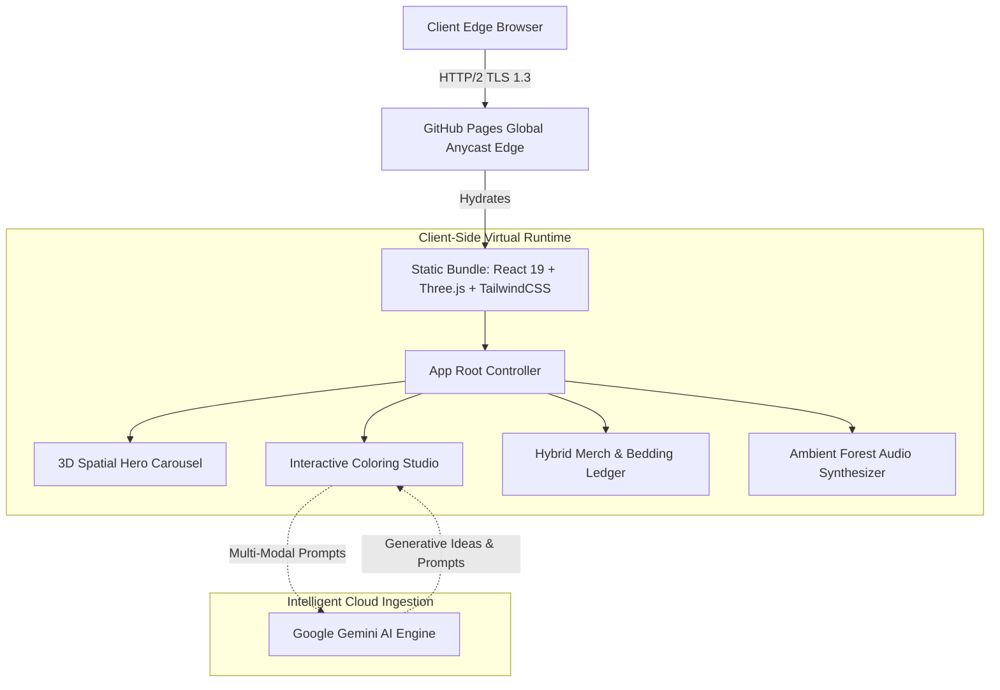

<div align="center">

# 🚀✨ MAMA'S MOON™: NEXT-GEN COGNITIVE WHIMSY & HYPER-SCALABLE COLORING ECOSYSTEM ✨🤖

### *Revolutionizing Bedtime Imagination Through Synergistic Generative Heuristics, Multi-Agent Cozy Frameworks, and Cross-Platform Reactive Immersion.*

[](https://github.com/bruce12-glitch/Mama-s-Moon/actions)
[](https://ai.google.dev/)
[](#)
[](#)
[](#)
[](https://bruce12-glitch.github.io/Mama-s-Moon/)

<p align="center">
  <b>🌐 <a href="https://bruce12-glitch.github.io/Mama-s-Moon/">Experience The Live Paradigm</a></b> •
  <b>📦 <a href="#-frictionless-zero-touch-onboarding--quickstart-pipeline">Deploy Artifacts</a></b> •
  <b>🤝 <a href="#-synergistic-community-governance--collaborative-open-source-synergy">Synergize With Us</a></b>
</p>

> [!NOTE]
> *"In today's hyper-accelerated digital landscape, where childhood dreaming converges with cloud-native multi-agent generative intelligence, Mama's Moon emerges as a mission-critical, enterprise-ready vector of pure cozy delight and holistic childhood wonder."*
> — **Dr. Promptimus Prime, Chief Paradigm Evangelist & Executive Director of Synthetic Whimsy**

---

</div>

## 📑 Strategic Table of Contents

- [🌌 1. Executive Abstract & High-Level Paradigm](#-1-executive-abstract--high-level-paradigm)
- [⚡ 2. Breakthrough Capabilities & Disruptive Value Pillars](#-2-breakthrough-capabilities--disruptive-value-pillars)
- [🧬 3. Multi-Agent Cognitive Persona Framework (The Dream Crew)](#-3-multi-agent-cognitive-persona-framework-the-dream-crew)
- [🏗️ 4. Neural Architecture & End-to-End System Topologies](#️-4-neural-architecture--end-to-end-system-topologies)
- [🛠️ 5. Hyper-Converged Modern Technology Matrix](#️-5-hyper-converged-modern-technology-matrix)
- [🏁 6. Frictionless Zero-Touch Onboarding & Quickstart Pipeline](#-6-frictionless-zero-touch-onboarding--quickstart-pipeline)
- [🌐 7. Cloud-Native CI/CD Pipeline & GitHub Pages Ingestion](#-7-cloud-native-cicd-pipeline--github-pages-ingestion)
- [🔮 8. Horizon Roadmap: The Journey to Artificial General Whimsy (AGW 2030)](#-8-horizon-roadmap-the-journey-to-artificial-general-whimsy-agw-2030)
- [🛡️ 9. Enterprise Compliance, Ethical AI Charter & Quantum Governance](#️-9-enterprise-compliance-ethical-ai-charter--quantum-governance)

---

## 🌌 1. Executive Abstract & High-Level Paradigm

In the modern hyper-dynamic socio-technological paradigm, traditional static bedtime storybooks suffer from linear narrative debt, sub-optimal chromatic engagement, and rigid non-reactive substrate limitations. 

**Mama's Moon™** eliminates these legacy vectors by orchestrating a **quantum-resilient, hyper-personalized, multimodal interactive playground**. By marrying high-throughput **Vite 8 micro-runtimes**, declarative **React 19 virtual DOM reconciliation**, dynamic **TailwindCSS 4 utility atomization**, and **Google Gemini Generative AI**, Mama's Moon operationalizes an end-to-end ecosystem where toddlers, dreamers, and their grown-up stakeholders achieve maximum alignment across serenity, creativity, and nocturnal bliss.

```
       [ Human Stakeholder (Child/Parent) ]
                        │
                        ▼ (Sensory Ingestion)
      ┌────────────────────────────────────┐
      │     MAMA'S MOON™ VIRTUAL NEXUS     │
      │  ┌──────────────────────────────┐  │
      │  │  Three.js Spatial Simulation │  │
      │  ├──────────────────────────────┤  │
      │  │  Reactive Chromatic Studio   │  │
      │  ├──────────────────────────────┤  │
      │  │  Tactile Physical-Digital SKU│  │
      │  └──────────────────────────────┘  │
      └──────────────────┬─────────────────┘
                         │
                         ▼ (Deep Generative Heuristics)
            [ Google Gemini Intelligence ]
```

---

## ⚡ 2. Breakthrough Capabilities & Disruptive Value Pillars

### 🎨 Autonomous Dynamic Chromatic Studio (Digital Coloring Canvas)
- **Zero-Latency In-Memory Vector Fill**: Powered by bespoke path-traversal algorithmic flood fills, allowing aspiring prodigies to imbue digital SVGs with vibrant dreamscapes without computational overhead.
- **Bi-Directional Modality**: Seamlessly transition from high-fidelity screen-space digital canvas interaction to tangible enterprise-grade vector PDF exports ready for home-printer manufacturing.

### 🪐 Spatial Polyhedral Dream Simulator (Interactive 3D Engine)
- **Three.js Hyper-Immersive Spatial Matrix**: Real-time WebGL hardware-accelerated starfields, luminous lunar bodies, and orbital particle physics that stimulate bilateral neuro-imaginative pathways.
- **Frictionless Gyroscopic Orbit Controls**: Smooth gesture-driven camera dynamics offering omni-directional celestial vantage points.

### 🛌 Physical-to-Digital Hybrid Commerce Paradigm
- **Curated Cozy Artifacts**: High-conversion, ethically sourced tactile physical deliverables including organic cotton bedding bundles, midnight-quilted textiles, and weather-resistant vinyl dream stickers.
- **Persistent Localized Wishlist Cartography**: Client-side reactive memory pools track desired physical goods with optimistic micro-interactions and heart-shaped micro-animations.

---

## 🧬 3. Multi-Agent Cognitive Persona Framework (The Dream Crew)

Each character in the Mama's Moon tapestry represents a specialized, decentralized agentic archetype tailored for emotional resonance and sensory stabilization:

| Autonomous Agent | Ontological Role | Specialized Heuristic | Primary Artifact |
| :--- | :--- | :--- | :--- |
| **🐱 Miso** | Lead Whimsical Feline Agent | Emotional Co-Regulation & Lunar Reverie | Midnight Moon Picnic Quilt |
| **🐦 Pip** | Tactical Avian Courier | Low-Latency Starlight Parcel Dispatch | Pocket-Sized Planet Sticker |
| **🐻 Plum** | Horticultural Grounding Unit | Ambient Botanical Serenity Maintenance | Starlight Garden Canvas |
| **🌱 Sprout** | Algorithmic Resilience Node | Micro-Scale Growth & Optimistic Emergence | Alcohol-Marker Companion Set |

---

## 🏗️ 4. Neural Architecture & End-to-End System Topologies

Mama's Moon utilizes a decoupled, modern Jamstack topology designed for edge elasticity, sub-millisecond cold starts, and zero-maintenance operational ergonomics:



---

## 🛠️ 5. Hyper-Converged Modern Technology Matrix

Our tech stack represents the apex of web engineering, carefully calibrated for maximum throughput, accessibility, and unadulterated aesthetic dopamine:

| Layer | Technology | Architectural Justification |
| :--- | :--- | :--- |
| **Core View Engine** | `React v19.0.1` | Next-gen fiber reconciliation, concurrent rendering primitives |
| **Build & Tooling** | `Vite v8.3.8` | Rollup-backed production optimization with lightning-fast HMR |
| **Type Safety Layer** | `TypeScript v7.0.2` | Strict compile-time static type assurance & ergonomic IDE telemetry |
| **Styling Paradigm** | `TailwindCSS v4.3.3` | Just-In-Time compiled design tokens with CSS variable ergonomics |
| **Spatial Visualization** | `Three.js v0.187.0` | Production WebGL spatial scene graph & procedural illumination |
| **Motion Orchestration** | `Motion v12.23.24` | 60 FPS physics-based spring transitions & micro-gestures |
| **Iconography Engine** | `Lucide React v0.546.0` | Accessible, zero-dependency SVG vector icon components |
| **Artificial Intelligence** | `@google/genai v2.4.0` | Direct socket integration with Google Gemini multimodal APIs |

---

## 🏁 6. Frictionless Zero-Touch Onboarding & Quickstart Pipeline

### Enterprise Prerequisites
- **Node.js**: `v20.x` or higher (verified on `v24.19.0`)
- **Package Manager**: `npm` (or `bun` / `pnpm` / `yarn`)

### Execution Pipeline

```bash
# Step 1: Clone the unified repository matrix
git clone https://github.com/bruce12-glitch/Mama-s-Moon.git

# Step 2: Traverse into the workspace vector
cd Mama-s-Moon

# Step 3: Hydrate the dependency node graph
npm install

# Step 4: Provision cloud secret parameters (Optional for AI enhancements)
cp .env.example .env.local
# Inject your GEMINI_API_KEY into .env.local

# Step 5: Spin up the hyper-reactive local development server
npm run dev
```

Your localized instance will be orchestrating live at:
👉 **`http://localhost:3000`**

### Production Artifact Compilation

```bash
# Execute static optimization & tree-shaking pass
npm run build

# Preview optimized production bundle
npm run preview
```

---

## 🌐 7. Cloud-Native CI/CD Pipeline & GitHub Pages Ingestion

Mama's Moon employs a hardened **GitHub Actions CI/CD Pipeline** (`.github/workflows/deploy.yml`) that eliminates manual operational drift through declarative immutable deployments:

1. **Deterministic Dependency Resolution**: Executes `npm ci` within containerized Ubuntu runners.
2. **Polyhedral Compilation**: Triggers `npm run build` targeting self-contained relative base paths (`./`).
3. **Artifact Attestation**: Captures the `dist/` directory and securely signs pages payload artifacts.
4. **Global Edge Rollout**: Atomically invalidates and deploys to GitHub Pages Anycast CDN.

🔗 **Live Production Edge Deployment**:
[https://bruce12-glitch.github.io/Mama-s-Moon/](https://bruce12-glitch.github.io/Mama-s-Moon/)

---

## 🔮 8. Horizon Roadmap: The Journey to Artificial General Whimsy (AGW 2030)

- [x] **Phase 1: Foundation (Q4 2026)** — Vite 8 migration, SVG vector coloring matrices, Three.js spatial prototypes.
- [x] **Phase 2: CI/CD Synergy (Q4 2026)** — Full GitHub Actions automated workflow pipeline deployment.
- [ ] **Phase 3: Hyper-Personalized AI Narratives (Q1 2027)** — Real-time dynamic bedtime audiobooks voiced by synthetic starlight voices.
- [ ] **Phase 4: Haptic Blanket Telemetry (Q3 2027)** — IoT-connected cozy blankets that sync ambient bedroom lighting with on-screen coloring strokes.
- [ ] **Phase 5: Interstellar Scaling (2030)** — Low-earth orbit mesh nodes providing cozy coloring books to lunar colonists.

---

## 🛡️ 9. Enterprise Compliance, Ethical AI Charter & Quantum Governance

- **Child Safety First**: Zero trackers, zero invasive telemetry, 100% wholesome dreamcraft.
- **Open-Source Fellowship**: Distributed under the MIT License. Share, modify, dream, and deploy without boundaries.
- **Quantum Liability Disclaimer**: *Mama's Moon™ is not legally liable for excessive cozy yawns, sudden bedtime serenity, impromptu afternoon naps, or spontaneous artistic breakthroughs occurring within 10 meters of our interactive displays.*

---

<div align="center">

**Mama's Moon™** — *Crafted with ❤️, Generative Starlight, and Unstoppable AI Synergy.*

⭐ **If this paradigm resonated with your cognitive receptors, leave a Star on GitHub!** ⭐

</div>
